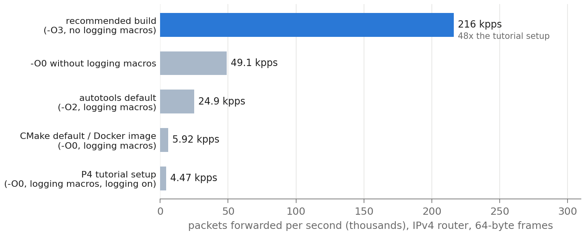
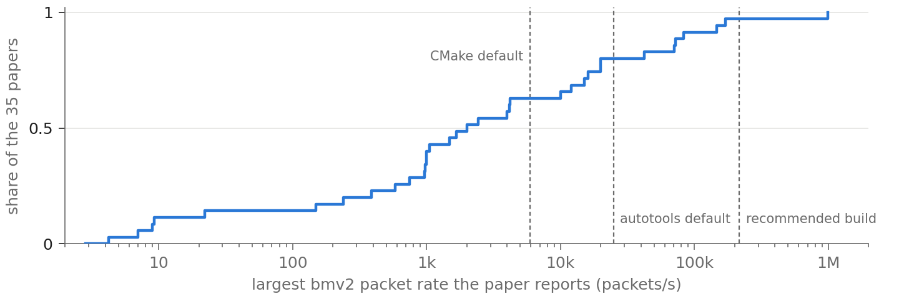

# How bmv2 Performance Depends on Build and Runtime Options

bmv2, the reference P4 software switch, is the data plane on which hundreds of papers measure the
throughput, latency and loss of their designs. These figures depend on how bmv2 was compiled and
started, yet the P4 tutorials, bmv2's CMake default and the official Docker image all build it
without optimisation and with logging macros, while its documentation recommends an optimised build
without them, and papers almost never mention these configurations. In this project, we measure
how much the build and start-up options change bmv2's forwarding capacity, and we examine how 253
papers that report bmv2 figures describe their setup.
A short paper describing this work is currently under review.

## Findings

**Build configuration.** On our machine, bmv2 with the recommended build forwards 216 kpps with an
IPv4 router program and 64-byte frames, 48 times as many frames as bmv2 built and started as in the
P4 tutorials (4.47 kpps). bmv2's CMake default and the official Docker image forward 5.9 kpps. Most
of this gap comes from the logging macros: removing them makes bmv2 8.3x faster at `-O0`, whereas
going from `-O0` to `-O2` without the macros makes it only 4.4x faster. Although nothing is logged,
at least half of the CPU cycles that bmv2 spends outside the kernel in the CMake default go to
formatting log messages.



*Table 1. Capacity C (median of 5 instances, 95 % bootstrap CI) of the router program for 64-byte
frames across eight build configurations.*

| build | optimisation | logging macros | event logger | C (kpps) | 95 % CI |
|---|:---:|:---:|:---:|---:|---:|
| bmv2's CMake default | `-O0` | on | on | 5.92 | [5.89, 5.94] |
| official Docker image | `-O0` | on | on | 5.89 | [5.87, 5.91] |
| autotools default | `-O2` | on | on | 24.94 | [24.78, 24.97] |
| custom CMake build | `-O2` | on | off | 25.03 | [24.80, 25.16] |
| custom CMake build | `-O0` | off | off | 49.08 | [48.89, 49.43] |
| custom CMake build | `-O2` | off | off | 214.75 | [213.65, 225.81] |
| recommended build, built with CMake | `-O3` | off | off | 220.02 | [214.74, 227.18] |
| recommended build | `-O3` | off | off | 216.26 | [212.31, 224.66] |

Table 1 also shows that `-O3` adds nothing over `-O2`, and that the event logger costs about 1 % when
no program reads its events. Turning on the three recording options that the P4 tutorials use
(`--log-console`, `--pcap`, `--nanolog`) lowers the capacity of the CMake default further, from 5.92
to 4.47 kpps; most of this cost comes from console logging.

**Comparisons between programs.** The build also changes comparisons between P4 programs. In 18 of
the 78 pairs of the 13 programs that we tested, the program that is faster with one build is slower
with the other. To see whether the gap also holds for programs that researchers actually evaluate, we ran three
programs from papers in our census with the authors' table entries (Table 2). The port-knocking and
P-IOTA programs gain about as much from the recommended build as our router program, but the GNN
program gains only 5.4x, because it spends 29 µs per packet even in the recommended build.

*Table 2. Capacity of the published programs and of our router program for 64-byte frames (median
of 5 instances).*

| program | CMake default (kpps) | recommended build (kpps) | ratio | time per packet, recommended build (µs) |
|---|---:|---:|---:|---:|
| router program (ours) | 5.92 | 216 | 36.5x | 4.6 |
| port knocking [1] | 2.18 | 78.1 | 35.9x | 12.8 |
| P-IOTA DDoS detection [2] | 1.61 | 75.3 | 46.8x | 13.3 |
| GNN ECN marking [3] | 6.35 | 34.0 | 5.4x | 29.4 |

**How papers report bmv2 performance.** We searched OpenAlex, arXiv and Semantic Scholar, found 2588
candidate papers, screened them down to 415, and kept the 253 papers that report at least one
performance figure measured on bmv2. For each paper we recorded the 14 setup fields of Table 3.

*Table 3. What 253 papers that report bmv2 figures state about their setup.*

| | field | reported | partial | not reported |
|---|---|---:|---:|---:|
| F1 | target binary named (`simple_switch`, ...) | 40 | – | 213 |
| F2 | bmv2 release or commit | 8 | 4 | 241 |
| F3 | build configuration | 0 | 11 | 242 |
| F4 | logging on or off at run time | 6 | 11 | 236 |
| F5 | how bmv2 was installed | 32 | – | 221 |
| F6 | P4 program | 150 | 95 | 8 |
| F7 | host CPU model | 83 | 71 | 99 |
| F8 | bmv2 run directly on the host, in a VM or in a container | 90 | – | 163 |
| F9 | emulation layer (Mininet, ...) | 223 | – | 30 |
| F10 | traffic tool (iperf3, ...) | 146 | – | 107 |
| F11 | packet size, frame or payload | 23 | 48 | 182 |
| F12 | packets per second | 60 | – | 193 |
| F13 | number of times each experiment was repeated, and the spread of its results | 38 | 88 | 127 |
| F14 | measurement showing that the traffic tools were not the bottleneck | 6 | 51 | 196 |

No paper reports its full build configuration in the text (F3). Even counting the 77 linked
repositories, for 200 of the 253 papers neither the text nor a linked repository mentions how bmv2
was built. Only 60 papers report packets per second, and only 6 show by measurement that the
traffic generator or the receiving host was not the bottleneck. The figure below plots the largest bmv2 rate in the 35
of these 60 papers whose figures we could convert. In 22 of them, this rate is below what even
bmv2's CMake default forwards on our machine. A reader therefore cannot tell from such a figure
whether bmv2, the link or the traffic source was the bottleneck.



*Figure. The largest bmv2 packet rate reported by each of 35 census papers. Vertical lines: the
capacity of our IPv4 router program with 64-byte frames on our machine for the CMake default, the
autotools default and the recommended build.*

## Reporting Checklist

Based on our census and our measurements, a bmv2 figure can be interpreted only if the paper also
reports the following six setup details:

1. **Build.** The optimisation level and whether the logging macros and the event logger were
   compiled in, best given as the full `configure` or CMake command line.
2. **Version and installation.** The bmv2 release or commit and how bmv2 was installed (tutorial
   VM, image tag, package, source).
3. **Run time.** The target (`simple_switch` or `simple_switch_grpc`) and the recording options
   (`--log-console`, `--log-file`, `-L`, `--pcap`, `--nanolog`).
4. **Traffic.** Packets per second with the frame size, the burstiness of the traffic, and where
   loss is counted.
5. **Instrument.** A measurement showing that the generator and the receiving host can carry more
   than the reported rate.
6. **Host.** CPU model, frequency control, and any VM or container.

## Measurement Setup

We run all measurements on one machine (Intel Core i5-12400F, Ubuntu 24.04) with the performance
governor and turbo disabled. We pin the switch, the generator and the receiver to separate physical
cores, and, as in Mininet, we run hosts and switch in separate network namespaces connected by veth
pairs.

We wrote a traffic generator and a receiver in C that use Linux raw packet sockets (`AF_PACKET`).
In each trial we verify that the instrument was not the limit: the generator must be able to send
at least three times the measured capacity, the frame counts of the generator and the receiver must
match the kernel's interface counters, and no process outside the experiment may use more than 5 %
of a CPU. A minimal forwarder that opens the ports through libpcap as bmv2 does reaches about four
times the rate of the fastest bmv2 build, so bmv2's own processing is the bottleneck.

We build bmv2 in all 12 combinations of optimisation level (`-O0`/`-O2`/`-O3`), logging macros
on/off and event logger on/off. Before running any trial, we registered the experiments, the
expected outcomes and the rules for judging them. Each figure is the median of five switch
instances, with a 95 % bootstrap confidence interval.

Experiment binaries never run as root. A small wrapper (`harness/priv/bmbench-priv`) is the only
program allowed through `sudo`; it sets up the namespaces and CPU mode, and runs each tool as a
normal user holding only `CAP_NET_RAW` and `CAP_NET_ADMIN`.

## Repository Layout

```
harness/
  src/      traffic generator (bmgen), receiver (bmrecv), minimal libpcap forwarder (bmnull),
            and bmnic, which turns off NIC offloads on the host veths as the P4 tutorials do
  run/      experiment orchestration (bench.py), plan generation, analysis and reports
  plans/    the experiment plans (JSON) that bench.py runs
  builds/   scripts that build the 12 bmv2 configurations and fetch the Docker image
  p4/       generator of the P4 test programs
  priv/     the root wrapper and the one-time machine setup
  tests/    offline tests, with fake binaries in place of bmv2, sudo and the NIC tools
data/
  census-253.csv     the 253 papers with the 14 setup fields we recorded for each
  reported-pps.json  the packet rates in the second figure
figures/             the figures above and the script that draws them
```

The three programs from published papers are not included; they can be obtained from their
authors' repositories.

## Running the Tests

The tests need Linux, `gcc`, `libpcap-dev` and Python 3, and no root.

```bash
cd harness
make test
python3 -m unittest discover -s tests -p 'test_*.py'
```

A measurement run needs a dedicated machine, the bmv2 builds from `harness/builds`, and the
one-time setup in `harness/priv/setup_testbed.sh`.

## References

1. A. Almaini et al. Lightweight edge authentication for software defined networks. *Computing*
   103(2), 2021. https://doi.org/10.1007/s00607-020-00835-4
2. A. Al Sadi et al. P-IOTA: A cloud-based geographically distributed threat alert system that
   leverages P4 and IOTA. *Sensors* 23(6), 2023. https://doi.org/10.3390/s23062955
3. I. P. Lamb et al. Distributed graph neural networks in programmable data planes. *NOMS 2025*.
   https://doi.org/10.1109/NOMS57970.2025.11073693
